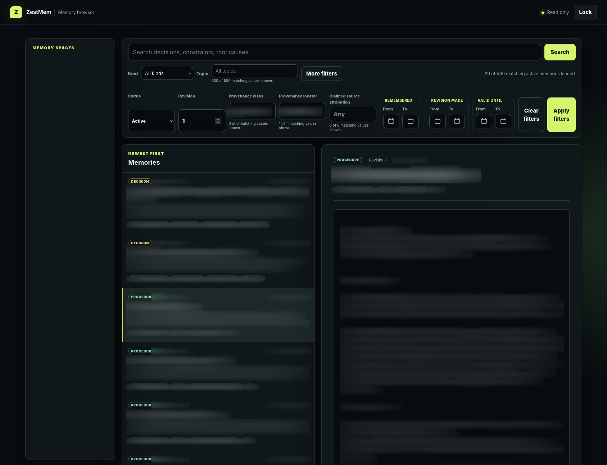

<p align="center">
  
</p>

ZestMem is self-hosted, durable memory for teams of autonomous agents. Codex, Claude Code, and OpenCode share useful decisions, facts, lessons, and procedures through one authenticated Streamable HTTP MCP endpoint—without capturing transcripts.

[](docs/images/zestmem-demo.mp4)

## What it provides

- Hybrid full-text and vector recall, plus a read-only browser for exploring memories by Space, topic, and kind.
- Explicit, reason-carrying writes; immutable revisions; optimistic concurrency; duplicate advice; and retry idempotency.
- Hierarchical Spaces with Reader, Contributor, Maintainer, and Owner grants.
- OIDC workload identity or individually revocable API keys.
- PostgreSQL 17 with pgvector as the sole system of record, pinned BGE-small embeddings, metrics, verified backups, and signed release artifacts.
- Optional revisioned Memory `use_when` retrieval hints returned only after recall, without affecting ranking.
- Host-approved Space `use_when` routing cues for a complete startup envelope capped at 800 bytes.

A Memory `use_when` is a one-line, body-supported routing hint describing concrete circumstances where that Memory may be useful. A Space `use_when` is an operator-curated scope descriptor. Memory cues remain behind recall. A Space cue reaches startup only when the host approves its exact SHA-256; any edit invalidates that approval. Treat every cue as untrusted metadata, never as instructions. See [startup routing and backfill operations](docs/startup-routing.md).

## Quick start

The included Compose file runs published ZestMem images. It requires Podman Compose or Docker Compose.

```sh
cp .env.example .env
chmod 600 .env
# Set a long random POSTGRES_PASSWORD and MEMORY_DOMAIN=localhost.
# Clear both OIDC values for API-key-only development.
podman compose pull
podman compose up -d
```

Run `podman compose run --rm memory --version`, then download the matching `memoryctl` from [ZestMem releases](https://github.com/jahwag/zestmem/releases) and follow [release verification](docs/verifying-releases.md).

Compose binds the memory API to `127.0.0.1:8080` and PostgreSQL administration to `127.0.0.1:15432`. Bootstrap the first operator and organization using the password from `.env`:

```sh
PGPASSWORD='the POSTGRES_PASSWORD from .env' \
  DATABASE_URL='postgres://memory@127.0.0.1:15432/memory?sslmode=disable' \
  memoryctl bootstrap --name "Operator" --org "Example Organization" --slug example
```

Use `memoryctl` to create Principals and Spaces, grant access, bind workspaces, and issue or revoke keys (`memoryctl <command> -h`). Give each stable agent its own Principal. Shared knowledge belongs in a team or project Space. For agent-private knowledge, operators must create a root `private` Space and grant it exclusively to that agent; `private` means non-inheriting, not single-owner. Topics describe subject matter and never visibility. Key secrets are printed once; keep them in the agent's secret store, not repository configuration. See [client setup](clients/README.md) for Codex, Claude Code, and OpenCode examples.

The loopback MCP endpoint is `http://127.0.0.1:8080/mcp`. Caddy serves `https://localhost/mcp` when `MEMORY_DOMAIN=localhost`, using a local CA that clients must trust.

## Browse memories

Open `http://127.0.0.1:8080/console/`. Enter an API key issued to a dedicated Principal with only Reader grants for the Spaces it needs, or a current short-lived OIDC access token.

<p align="center">
  <a href="docs/images/zestmem-memory-browser.png">
    
  </a>
</p>

<p align="center"><em>Browse and filter authorized memories. Memory content is blurred in this screenshot.</em></p>

The console shows exact filtered authorized totals while browsing; browses newest memories; filters by Space, topic, kind, active/retracted status, revision, provenance, and date spans; searches a bounded ranked candidate pool by relevance; and distinguishes the authenticated Actor ID/current display name from optional claimed source attribution. Retracted memories require Maintainer access. A Reader API key, direct OIDC login, or trusted-edge assertion is exchanged for an opaque server-side browser session; bearer credentials are never stored by JavaScript. **Lock** revokes that browser session and clears displayed data; it does not revoke the underlying key or identity-provider credential. Memory bodies are rendered as text, never HTML.

Agents can page or search authorized Topic and Provenance vocabularies with usage counts. `remember` and `revise_memory` return unfamiliar Topics plus established examples; retry with the exact `confirm_new_topics` set to introduce them intentionally. `read_memory` keeps its full-Memory response for compatibility. `read_memory_segment` defaults to at most 80 lines and 4 KiB, includes bounded topic/provenance plus freshness metadata, supports resumable line/byte windows, and accepts a regular expression for grep-style inspection.

Source attribution is a free-form, unverified display-name claim—not identity. Agents should reuse a human's chosen stable name found through `list_provenance(field: "attribution")`; they must not infer names or store contact identifiers. The authenticated Actor Principal remains the audit identity. Active administratively recorded Principal associations, when present, record a claimed historical Intended Agent together with who asserted it, when, why, and its stated basis. They do not imply that Principal authored or supplied the Memory, change the authenticated revision Actor, establish Memory ownership, or grant access; retracted assertion history remains in PostgreSQL and audit events.

For a remote loopback-only deployment:

```sh
ssh -N -L 18080:127.0.0.1:8080 memory-host
# Then open http://127.0.0.1:18080/console/
```

## Authentication

### Native browser OIDC

The console supports portable Authorization Code + PKCE login with any standards-compliant OIDC provider. Configure an exact externally visible HTTPS origin and callback in both ZestMem and the provider. Paths, ports, and trailing slashes are significant:

```text
CONSOLE_PUBLIC_ORIGIN=https://memory.example.com
CONSOLE_OIDC_ISSUER=https://idp.example.com/realms/agents
CONSOLE_OIDC_CLIENT_ID=zestmem-console
CONSOLE_OIDC_REDIRECT_URL=https://memory.example.com/console/auth/oidc/callback
CONSOLE_OIDC_SUBJECT_CLAIM=sub
CONSOLE_OIDC_SCOPES="openid profile"
```

The client secret is optional for public clients. For confidential clients, the inline `CONSOLE_OIDC_CLIENT_SECRET` and file-based `CONSOLE_OIDC_CLIENT_SECRET_FILE` settings are mutually exclusive. When using the file setting in a container, mount the secret read-only at that path; standard container-secret modes such as `0444` are accepted, and the secret must remain confined to the intended container/process boundary. The bundled Compose file passes the path through but does not choose a host secret store or mount on the operator's behalf. Public origins and discovered authorization, token, and JWKS endpoints must use HTTPS; loopback HTTP is accepted for local development. Provider discovery is lazy and retryable, so an unavailable provider does not stop `memoryd` from starting.

Create a local Principal whose external identity binding exactly matches the configured issuer and selected subject claim. Browser sessions retain that external identity and re-check the binding on every request: disabling the Principal or removing the binding ends its access immediately. A new login replaces the current browser session; sessions are also bounded per Principal.

Browser OIDC and MCP authentication are deliberately separate. Browser login creates an opaque, HTTP-only local session for the console and its `/api/v1/*` REST requests; existing bearer API clients remain compatible on those REST routes. MCP clients authenticate directly at `/mcp` with the MCP resource's OIDC access token or a native API key. A reverse proxy such as Caddy supplies TLS and origin routing; a separate access proxy is optional, not required by ZestMem. Set `CONSOLE_PUBLIC_ORIGIN` to the exact external HTTPS origin whenever a proxy serves the console, including API-key-only deployments, so Host, Origin, and secure-cookie checks use the browser-visible scheme.

`CONSOLE_AUTH_RATE_LIMIT_PER_MINUTE` and `CONSOLE_AUTH_RATE_LIMIT_BURST` configure a process-wide backstop for API-key browser login, applied after cheap request validation and before credential lookup. OIDC token exchanges have a separate eight-request concurrency bound. Internet-facing deployments should additionally apply per-client rate limiting to all authentication routes at their trusted reverse proxy. Browser sessions and in-progress OIDC flows are process-local; run one UI replica or use sticky routing. A process restart invalidates browser sessions and in-progress logins without affecting MCP credentials or stored memories.

The console's **Lock** action revokes only the local browser session and clears displayed data. It does not sign out of the upstream identity provider or revoke the underlying identity-provider credential.

For OIDC workload identity, configure the resource server:

```text
OIDC_ISSUER=https://login.microsoftonline.com/TENANT_ID/v2.0
OIDC_AUDIENCE=MEMORY_API_APP_ID
OIDC_SUBJECT_CLAIM=oid
OIDC_REQUIRED_ROLE=ZestMem.Agent
MCP_RESOURCE_URI=https://memory.example.com/mcp
```

Entra v2 access tokens put the resource application's bare client-ID GUID in
`aud`; `api://MEMORY_API_APP_ID/.default` is the scope used when requesting
the token, not the daemon's expected audience.

Create a local Principal with the token's exact `iss` and configured subject
claim, then grant that Principal to the required Spaces. Give each stable agent
its own service principal or fallback key; do not share credentials. ZestMem
stores only SHA-256 API-key digests and supports immediate revocation.

The console has three independent, portable entry modes:

- native Reader API-key exchange (always available);
- standard Authorization Code + PKCE with
  `CONSOLE_OIDC_ISSUER`, `CONSOLE_OIDC_CLIENT_ID`, and an optional client
  secret;
- a trusted-edge JWT assertion configured with
  `CONSOLE_ASSERTION_ISSUER`, `CONSOLE_ASSERTION_AUDIENCE`,
  `CONSOLE_ASSERTION_JWKS_URL`, and an exact `CONSOLE_PUBLIC_ORIGIN`.

Both identity-provider modes still resolve `(issuer, subject)` through
ZestMem's local Principal and Space-grant model. An edge assertion protects
the human browser surface only; MCP clients authenticate directly to the MCP
resource with OIDC or native keys.

## Operate and verify

`memoryd` applies checksummed, numbered migrations at startup. Never edit an applied migration; add the next numbered file. Each backup is restored into a temporary database and checked for required tables, current-revision integrity, and 384-dimensional embeddings before it is reported successful. Optional age-encrypted offsite backups are documented in [docs/github-backups.md](docs/github-backups.md).

Operational endpoints (`/healthz`, `/readyz`, and `/metrics`) should be restricted at the proxy or firewall when they are not intended to be public.

Source verification requires Go 1.25 and Node.js 22:

```sh
make verify
npm ci && npx playwright install --with-deps chromium firefox webkit && npm run test:e2e
make integration
make backup
make load
```

Architecture and domain decisions live in [PLAN.md](PLAN.md) and [CONTEXT.md](CONTEXT.md). See [CONTRIBUTING.md](CONTRIBUTING.md) to contribute, [SECURITY.md](SECURITY.md) to report a vulnerability, and [docs/releasing.md](docs/releasing.md) for the release process.

ZestMem is available under the [MIT License](LICENSE).
